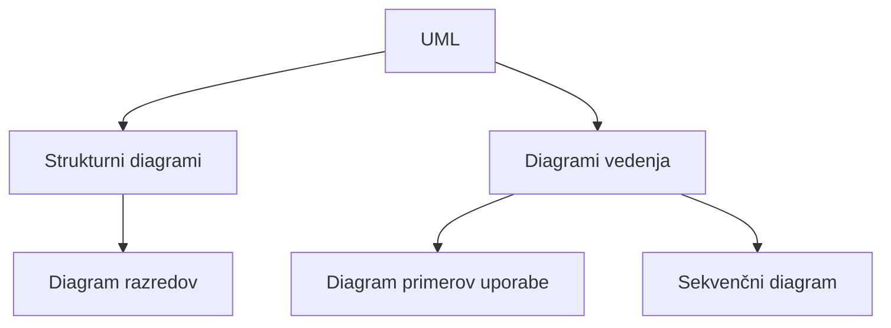
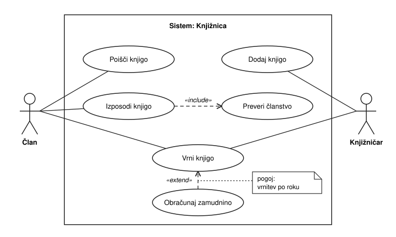
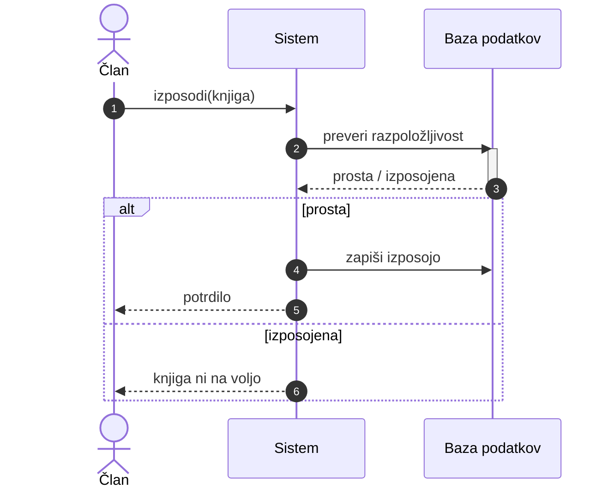
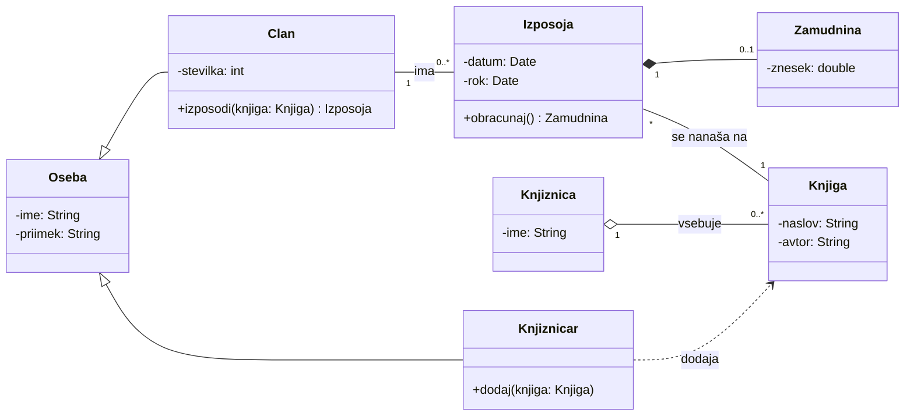

---
tags:
  - racunalnistvo
  - uml
---

# UML - pregled

Prej: [[01 Zahteve in uporabniške zgodbe|zahteve in uporabniške zgodbe]].

**UML** (Unified Modeling Language) je grafični modelirni jezik: skupen način, kako s *skicami* (diagrami) opišemo programsko opremo, še preden jo napišemo. Vsak diagram pokaže sistem z drugega zornega kota, zato jih je več vrst.

## Dve glavni skupini

| Skupina                      | Angleško           | Kaj pokaže                             |
| ---------------------------- | ------------------ | -------------------------------------- |
| Strukturni diagrami          | Structure Diagrams | iz **česa** je sistem sestavljen       |
| Diagrami vedenja (obnašanja) | Behavior Diagrams  | **kaj sistem počne** in kako se obnaša |

## Skica: delitev diagramov



## Diagrami v teh zapiskih

| Diagram | Angleško | Skupina | Na kaj odgovarja | Razdelek |
|-|-|-|-|-|
| Diagram primerov uporabe | Use Case Diagram | vedenje | Kaj lahko uporabnik naredi s sistemom? | [[#Diagram primerov uporabe]] |
| Sekvenčni diagram (diagram poteka zaporedij) | Sequence Diagram | vedenje | V kakšnem vrstnem redu si sledijo sporočila? | [[#Sekvenčni diagram]] |
| Diagram razredov | Class Diagram | struktura | Kateri razredi so in kako so povezani? | [[#Diagram razredov]] |

Poenostavljena pot od ideje do kode: zahteve → uporabniške zgodbe → diagram primerov uporabe → sekvenčni diagram → diagram razredov → koda.

> [!info] Kaj je iz predavanj
> Delitev na dve skupini in imena treh diagramov so iz zapiskov s predavanj. Razlage, zapis (notacija) in primer »knjižnica« so dodani za lažje učenje; primer je izmišljen.

> [!note] Drugi diagrami (niso del predavanj)
> Strukturni so še npr. diagram objektov (object), komponent (component) in razmestitve (deployment). Vedenjski so še npr. diagram aktivnosti (activity), stanj (state machine) in komunikacije (communication).

## Diagram primerov uporabe

**Diagram primerov uporabe** (Use Case Diagram) spada med [[#Dve glavni skupine|diagrame vedenja]] in opisuje **interakcijo med uporabnikom in sistemom**: kdo lahko kaj dela s sistemom. Ne pokaže, *kako* sistem to naredi znotraj, in ne pokaže vrstnega reda korakov (za to je [[#Sekvenčni diagram|sekvenčni diagram]]).

### Gradniki

| Gradnik | Angleško | Kako ga narišemo | Pomen |
|-|-|-|-|
| Akter | Actor | človeška figura (lutka) z imenom | oseba ali zunanji sistem, ki uporablja sistem; je *vloga* iz uporabniške zgodbe |
| Primer uporabe | Use Case | elipsa z imenom (glagol + predmet) | ena stvar, ki jo sistem nudi akterju; je *cilj* iz uporabniške zgodbe |
| Meja sistema | System boundary | pravokotnik okoli primerov uporabe, ime sistema zgoraj | kaj je znotraj sistema; akterji so zunaj |
| Povezava | Association | polna črta med akterjem in primerom uporabe | akter sodeluje v tem primeru uporabe |

### Skica: knjižnica



Član išče, izposoja in vrača knjige. Knjižničar sprejme vrnitev in dodaja knjige.

### include in extend

| | «include» (vključitev) | «extend» (razširitev) |
|-|-|-|
| Kako narišemo | črtkana puščica z odprto konico | črtkana puščica z odprto konico |
| Puščica gre | od **osnovnega** k **vključenemu** primeru | od **razširitve** k **osnovnemu** primeru |
| Kdaj se zgodi | **vedno** (kot klic podprograma) | **včasih**, pod pogojem (pogoj zapišemo v opombi) |
| Osnovni primer | brez vključenega ni popoln | deluje tudi brez razširitve |
| V skici | Izposodi knjigo → Preveri članstvo | Obračunaj zamudnino → Vrni knjigo |

### Postopek

1. Iz uporabniških zgodb izpiši vloge: to so **akterji**.
2. Iz zgodb izpiši cilje: to so **primeri uporabe**.
3. Okoli primerov nariši **mejo sistema**, akterje postavi zunaj nje.
4. Poveži vsakega akterja s primeri, ki jih uporablja.
5. Del, ki ga potrebuje več primerov, izloči z «include». Redek ali neobvezen del označi z «extend».

> [!example]- Urejljiva različica skice (Mermaid)
> Mermaid nima ustaljene vrste za diagram primerov uporabe (najnovejši ima le poskusno `usecase-beta`), zato je skica tu narejena kot diagram poteka: akter je okvir z oznako «actor», primer uporabe je zaobljen oval, meja sistema je okvir. Pri ročni risbi akterja nariši kot lutko, primer uporabe pa kot elipso.
>
> ```mermaid
> flowchart LR
>     clan["«actor»<br/>Član"]
>     knjiznicar["«actor»<br/>Knjižničar"]
>     subgraph sistem["Sistem: Knjižnica"]
>         isci(["Poišči knjigo"])
>         izposodi(["Izposodi knjigo"])
>         vrni(["Vrni knjigo"])
>         dodaj(["Dodaj knjigo"])
>         clanstvo(["Preveri članstvo"])
>         zamudnina(["Obračunaj zamudnino"])
>     end
>     clan --- isci
>     clan --- izposodi
>     clan --- vrni
>     vrni --- knjiznicar
>     dodaj --- knjiznicar
>     clan ~~~ dodaj
>     izposodi -. "«include»" .-> clanstvo
>     zamudnina -. "«extend»" .-> vrni
> ```

## Sekvenčni diagram

**Sekvenčni diagram** ali **diagram poteka zaporedij** (Sequence Diagram) spada med [[#Dve glavni skupine|diagrame vedenja]], natančneje med interakcijske diagrame. Pokaže, **v kakšnem vrstnem redu si sledijo sporočila** med udeleženci pri **enem scenariju**, npr. pri enem [[#Diagram primerov uporabe|primeru uporabe]].

### Gradniki

| Gradnik | Angleško | Kako ga narišemo | Pomen |
|-|-|-|-|
| Udeleženec | Participant | pravokotnik z imenom na vrhu | kdo sodeluje (objekt, del sistema) |
| Akter | Actor | lutka na vrhu | uporabnik ali zunanji sistem |
| Življenjska črta | Lifeline | pravokotnik (»glava«) in od njega navpična, običajno črtkana črta navzdol | udeleženec skozi čas; **čas teče navzdol** |
| Sporočilo | Message | vodoravna puščica med življenjskima črtama | en klic ali odgovor |
| Sinhroni klic | Synchronous call | polna črta, **polna** konica | pošiljatelj počaka na odgovor |
| Asinhroni klic | Asynchronous call | **odprta** konica | pošiljatelj ne čaka |
| Odgovor | Reply | **črtkana** črta, odprta konica | vrnitev rezultata |
| Aktivacija | Activation | ozek pravokotnik na življenjski črti | udeleženec v tem času izvaja nalogo |
| Okvir | Combined fragment | okvir z oznako `alt`, `opt` ali `loop` | izbira (če ... sicer), neobvezen del, ponavljanje |

### Skica: izposoja knjige



> [!note] Puščice v skici
> Mermaid nariše vse puščice s polno konico, v UML pa ima odgovor odprto konico. Odgovor zato prepoznaš po črtkani črti.

#### Kako brati

1. Član pokliče `izposodi(knjiga)` pri sistemu (sinhroni klic: polna črta, polna konica).
2. Sistem vpraša bazo, ali je knjiga prosta. Baza je, dokler obdeluje poizvedbo, **aktivna** (ozek pravokotnik).
3. Baza odgovori (črtkana črta).
4. `alt`: če je knjiga **prosta**, sistem zapiše izposojo (4) in potrdi članu (5).
5. Sicer (6) članu sporoči, da knjige ni.

## Diagram razredov

**Diagram razredov** (Class Diagram) je glavni diagram iz skupine [[#Dve glavni skupine|strukturnih diagramov]] (Structure Diagrams). Prikazuje razrede (objekte) v obliki tabel z **atributi**, **metodami** in **povezavami** med njimi.

Razred je predloga (npr. `Knjiga`), objekt je konkreten primerek (konkretna knjiga »Mali princ«).

### Razred

Pravokotnik, ki ga vodoravni črti razdelita na tri dele:

| Del | Vsebina | Primer |
|-|-|-|
| zgoraj | ime razreda (z veliko začetnico) | `Clan` |
| sredina | atributi (podatki) | `-stevilka: int` |
| spodaj | metode (operacije) | `+izposodi(knjiga: Knjiga): Izposoja` |

Imena atributov in metod pišemo z malo začetnico. Pred njimi je znak **vidnosti** (visibility):

| Znak | Pomen |
|-|-|
| `+` | javno (public) |
| `-` | zasebno (private) |
| `#` | zaščiteno (protected) |
| `~` | paketno (package) |

### Povezave med razredi

| Povezava | Angleško | Kako jo narišemo | Pomen | V skici |
|-|-|-|-|-|
| Asociacija | Association | polna črta | razreda se poznata ali sodelujeta | Clan — Izposoja |
| Agregacija | Aggregation | polna črta, **prazen romb** ◇ pri celoti | »ima«: del lahko obstaja tudi sam | Knjiznica ◇— Knjiga |
| Kompozicija | Composition | polna črta, **poln (črn) romb** ◆ pri celoti | »je sestavljen iz«: del ne obstaja brez celote | Izposoja ◆— Zamudnina |
| Posplošitev (dedovanje) | Generalization | polna črta, **prazen trikotnik** pri splošnem razredu | »je vrsta« | Clan je Oseba |
| Odvisnost | Dependency | **črtkana** puščica od odvisnega k tistemu, od katerega je odvisen | »uporablja« (npr. kot parameter metode) | Knjiznicar ⇢ Knjiga |
| Realizacija | Realization | črtkana črta s praznim trikotnikom, od razreda k vmesniku | razred izvaja vmesnik (interface) | ni v skici |

#### Kratnost (Multiplicity)

| Zapis | Pomen |
|-|-|
| `1` | natanko eden |
| `0..1` | nič ali eden |
| `*` (tudi `0..*`) | nič ali več |
| `1..*` | vsaj eden |

Številka ob razredu pove, koliko primerkov **tega** razreda je povezanih z enim primerkom drugega razreda.

### Skica: knjižnica



#### Kako brati

- `Clan` in `Knjiznicar` **dedujeta** od `Oseba` (trikotnik je pri `Oseba`).
- Član ima 0 ali več izposoj, izposoja ima natanko enega člana in natanko eno knjigo.
- Knjižnica **vsebuje** knjige (agregacija): knjiga obstaja tudi brez te knjižnice.
- Zamudnina je del izposoje (kompozicija): brez izposoje ne obstaja, izposoja pa ima 0 ali 1 zamudnino.
- Knjižničar **uporablja** knjigo, ko jo dodaja (odvisnost).
